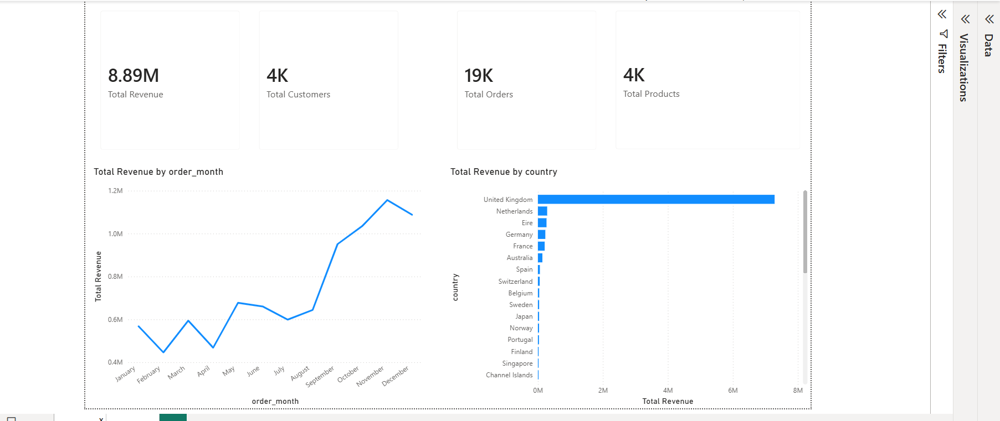
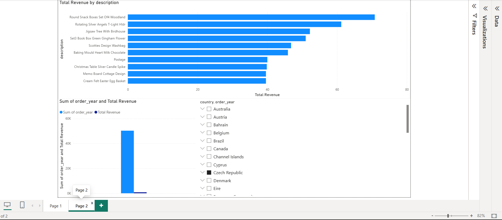

# 🛍️ Retail Data Platform

An end-to-end data engineering project: a modular Python ETL pipeline that validates, cleans, and enriches ~540K raw retail transactions, loads them into SQLite, and feeds a two-page Power BI dashboard.

   

---

## Table of Contents

- [Overview](#overview)
- [Dashboard Preview](#dashboard-preview)
- [Architecture](#architecture)
- [Pipeline Stages](#pipeline-stages)
- [Results at a Glance](#results-at-a-glance)
- [Data Model](#data-model)
- [Project Structure](#project-structure)
- [Getting Started](#getting-started)
- [Querying the Database](#querying-the-database)
- [Roadmap](#roadmap)
- [Author](#author)

---

## Overview

Raw retail exports are messy: cancelled invoices, missing customer IDs, zero or negative quantities and prices, and duplicate rows. This project turns the public **Online Retail** dataset (a UK-based online retailer, Dec 2010 – Dec 2011) into an analysis-ready table through a repeatable pipeline:

1. **Extract** the Excel source into a DataFrame
2. **Validate** structure and quality
3. **Clean** invalid and duplicate records
4. **Transform** with business features such as revenue and weekend flags
5. **Load** into SQLite and export a cleaned CSV
6. **Visualize** in Power BI

Every run is logged to `logs/etl.log` with timestamps and row counts.

## Dashboard Preview

**Executive dashboard**: revenue, customers, orders, products, monthly trend, revenue by country



**Product analysis**: top revenue-generating products



## Architecture

```text
 data/raw/Online Retail.xlsx
            │
            ▼
   ┌─────────────────┐
   │     Extract     │  scripts/extract.py
   └────────┬────────┘
            ▼
   ┌─────────────────┐
   │     Validate    │  scripts/validate.py
   └────────┬────────┘
            ▼
   ┌─────────────────┐
   │      Clean      │  scripts/clean.py
   └────────┬────────┘
            ▼
   ┌─────────────────┐
   │    Transform    │  scripts/transform.py
   └────────┬────────┘
            │
   ┌────────┴─────────┐
   ▼                  ▼
 SQLite DB       Cleaned CSV
 (retail.db)     (data/processed)
   │                  │
   └────────┬─────────┘
            ▼
    Power BI Dashboard
```

## Pipeline Stages

| Stage | What happens |
|-------|--------------|
| **Extract** | Reads `Online Retail.xlsx` with Pandas and logs the row count. |
| **Validate** | Checks required columns, duplicates, missing values, expected data types, and negative `Quantity` / `UnitPrice` values. |
| **Clean** | Normalizes column names (lowercase, underscores), trims whitespace, title-cases text fields, drops duplicates, **cancelled orders** (invoice numbers starting with `C`), rows with **missing customer IDs**, and rows with **non-positive quantity or price**. |
| **Transform** | Adds `revenue`, `order_month`, `order_year`, `order_day`, `is_weekend`, and `high_value_order` (revenue ≥ 1000). |
| **Load** | Writes the `retail_sales` table to SQLite (replaced on each run) and exports `data/processed/retail_cleaned.csv`. |

## Results at a Glance

Figures computed from the `retail_sales` table produced by the pipeline:

| Metric | Value |
|--------|-------|
| Clean transaction rows | 392,692 |
| Unique customers | 4,338 |
| Unique orders | 18,532 |
| Unique products | 3,665 |
| Total revenue | ≈ 8.89M |
| Date range | 2010-12-01 → 2011-12-09 |
| Top market | United Kingdom (≈ 7.29M), followed by Netherlands and Eire |

## Data Model

Single denormalized table: `retail_sales`

| Column | Type | Description |
|--------|------|-------------|
| `invoiceno` | INTEGER | Invoice number |
| `stockcode` | TEXT | Product code |
| `description` | TEXT | Product name |
| `quantity` | INTEGER | Units purchased |
| `invoicedate` | TIMESTAMP | Order date and time |
| `unitprice` | REAL | Price per unit |
| `customerid` | REAL | Customer identifier |
| `country` | TEXT | Customer country |
| `revenue` | REAL | `quantity × unitprice` |
| `order_month` | TEXT | Month name |
| `order_year` | INTEGER | Year |
| `order_day` | TEXT | Day of week |
| `is_weekend` | INTEGER | 1 if Saturday or Sunday |
| `high_value_order` | INTEGER | 1 if revenue ≥ 1000 |

## Project Structure

```text
Retail-Data-Platform/
├── data/
│   ├── raw/                  # Source Excel file
│   └── processed/            # Cleaned CSV output (git-ignored)
├── database/
│   ├── database.py           # SQLite connection and load helpers
│   └── retail.db             # Generated when you run main.py (not included)
├── images/                   # Dashboard screenshots
├── scripts/
│   ├── extract.py
│   ├── validate.py
│   ├── clean.py
│   ├── transform.py
│   ├── logger.py
│   └── report.py             # ETL summary report helper
├── check_database.py         # Quick sanity check of the DB
├── main.py                   # Pipeline entry point
├── requirements.txt
└── README.md
```

## Getting Started

**Prerequisites:** Python 3.9+

```bash
# 1. Clone
git clone https://github.com/Abdul-Rahman-Zaid/Retail-Data-Platform-end-to-end-.git
cd Retail-Data-Platform-end-to-end-

# 2. (Optional) create a virtual environment
python -m venv venv
source venv/bin/activate        # Windows: venv\Scripts\activate

# 3. Install dependencies
pip install -r requirements.txt

# 4. Make sure the output folder exists
mkdir -p data/processed

# 5. Run the pipeline (creates database/retail.db)
python main.py
```

After a successful run you will have:

- `database/retail.db` with the `retail_sales` table
- `data/processed/retail_cleaned.csv`
- `logs/etl.log`

## Querying the Database

Run the pipeline first so `database/retail.db` exists, then preview the first rows:

```bash
python check_database.py
```

Or run your own SQL, for example revenue by country:

```sql
SELECT country, ROUND(SUM(revenue), 2) AS total_revenue
FROM retail_sales
GROUP BY country
ORDER BY total_revenue DESC
LIMIT 10;
```

## Roadmap

- [ ] Star schema with fact and dimension tables
- [ ] Incremental loads instead of full table replacement
- [ ] PostgreSQL as the target warehouse
- [ ] Orchestration with Apache Airflow
- [ ] Docker packaging
- [ ] Cloud deployment (AWS S3, Glue, Redshift)
- [ ] Unit tests for validation and cleaning functions
- [ ] Wire up `report.py` to write an ETL summary after each run

## Author

**Mohammed Abdul Rahman Zaid**, aspiring Data Engineer
GitHub: [@Abdul-Rahman-Zaid](https://github.com/Abdul-Rahman-Zaid)
